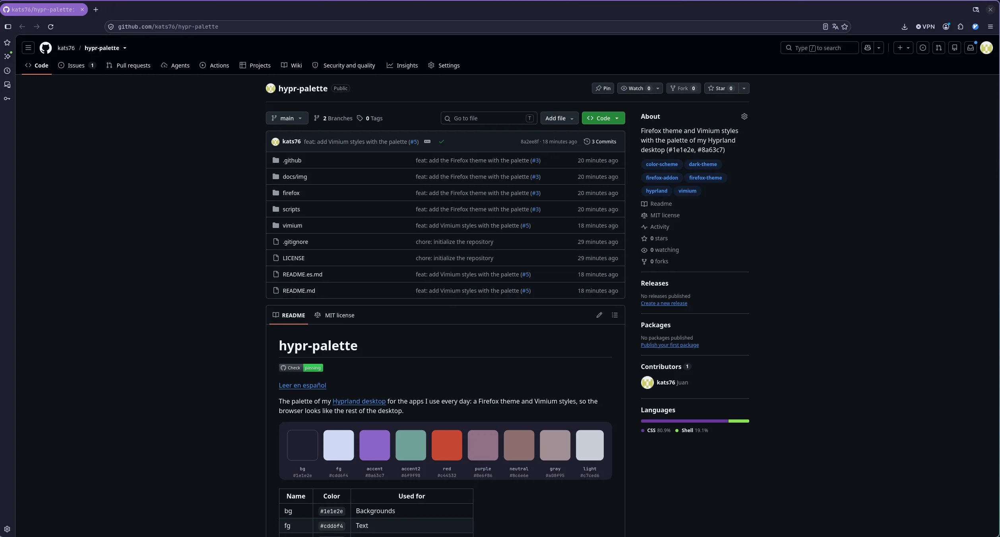
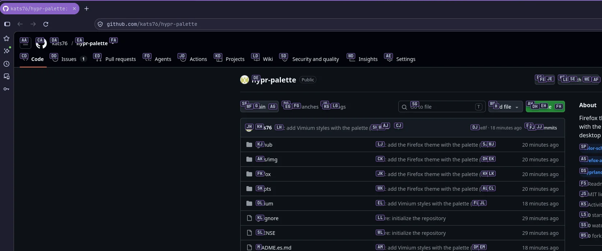
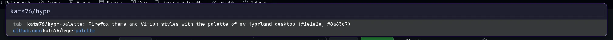

# hypr-palette

[Read in English](README.md)

Una paleta oscura y tranquila: fondos azul marino con acentos en morado suave y verde azulado, la misma de mi [escritorio Hyprland](https://github.com/kats76/dotfiles). Cada color tiene una única función en todas partes: el morado marca lo activo y el verde azulado lo que está bajo el cursor. Aquí está como tema de Firefox y estilos para Vimium.

| Nombre | Color | Para qué |
| --- | --- | --- |
| bg | `#1e1e2e` | Fondos |
| fg | `#cdd6f4` | Texto |
| accent | `#8a63c7` | Pestaña activa, selección, elementos con foco |
| accent2 | `#6f9f98` | Hover, borde con foco, carga |
| gray | `#a08f95` | Pestañas inactivas, bordes |
| light | `#c7ced6` | Texto sobre `accent` |

## Tema de Firefox

`firefox/manifest.json` es un tema de Firefox: ventana, barra de herramientas, menús y barra lateral en `bg`, la pestaña activa en `accent` (como el escritorio activo de waybar), la barra de direcciones un tono por encima de `bg` con borde `accent2` al tener el foco, y `accent2` al pasar el ratón. Las ventanas privadas mantienen el diseño morado propio de Firefox, así que se siguen distinguiendo.

**Instalar:** está en revisión en addons.mozilla.org. El enlace para instalarlo estará aquí cuando lo aprueben.

**Probarlo sin instalar:** abre `about:debugging#/runtime/this-firefox`, pulsa *Cargar complemento temporal…* y elige `firefox/manifest.json`. Desaparece al cerrar Firefox.

**Publicar una versión nueva:**

1. Cambia los colores en `firefox/manifest.json` y sube `version`.
2. `./scripts/build-firefox.sh` genera `dist/hypr-palette-<versión>.zip`.
3. Súbelo como versión nueva en la página del complemento en el [Developer Hub](https://addons.mozilla.org/developers/).

El CI ejecuta `web-ext lint`, el mismo linter de Mozilla que revisa cada envío.

## Vimium

`vimium/hypr-palette.css` da estilo a [Vimium](https://github.com/philc/vimium), la extensión para navegar con el teclado: etiquetas de enlaces en `bg` con borde `accent` y las letras escritas en `accent2`, la barra de búsqueda (Vomnibar) con el resultado seleccionado en `accent` y los avisos de abajo (buscar en la página, modo visual) a juego. JetBrainsMono en todo.

**Aplicar:** opciones de Vimium → *CSS para la interfaz de Vimium* (en las opciones avanzadas) → pegar el fichero y guardar. Pulsa `f` en cualquier página para ver las etiquetas y `o` para la barra de búsqueda.

## Flujo de trabajo

El mismo flujo que en mis otros repos: **`dev` es para probar y `main` es lo publicado.** Cada cambio empieza como una issue, pasa por una rama y una pull request a `dev` (Conventional Commits, squash merge), y `main` avanza hasta `dev` con fast-forward una vez probado.

## Licencia

[MIT](LICENSE). En addons.mozilla.org el tema figura con Creative Commons Attribution 4.0, la opción más parecida que ofrece Mozilla para temas.
